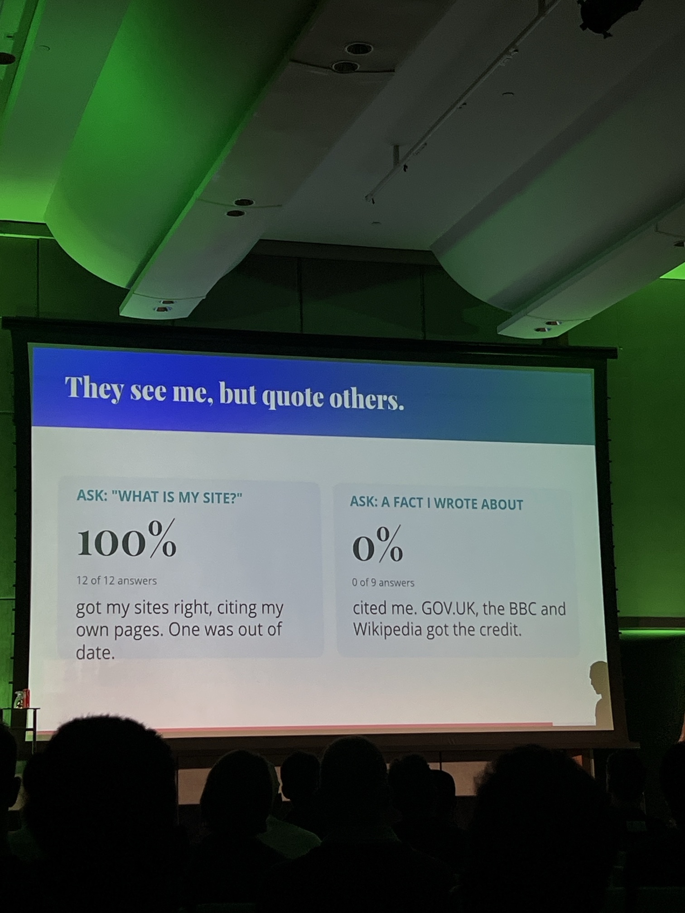
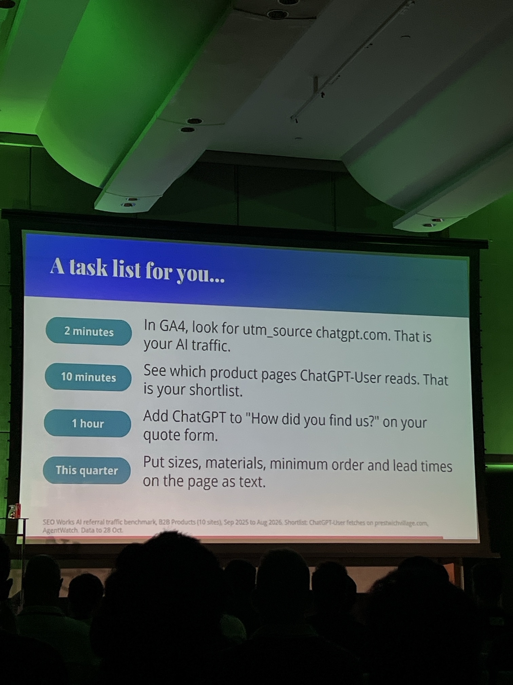
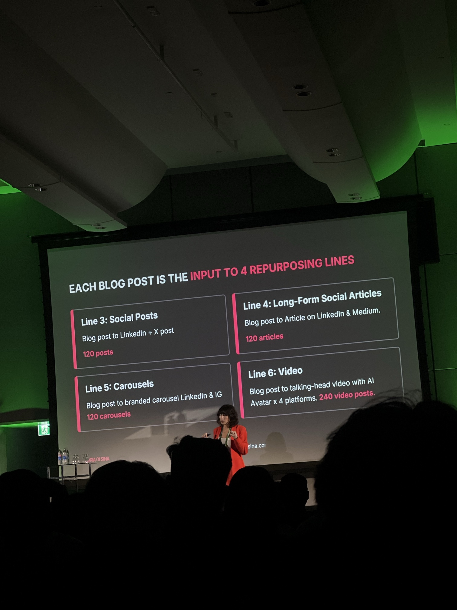

# Day 1: Monday 9 November

## Alex Moss (Yoast and FireCask): "If You Build It, Will They Come?"

2:00 to 2:40pm, Suthep Hall 3, Technical SEO track

This year Alex rebuilt two ordinary content sites so AI agents could use them, then measured which crawlers and agents turned up and what they did.

### Test sites

- **familyguy.co.uk:** an unofficial Family Guy episode database. Its About page says Alex runs it as "a live test site for how search engines and AI assistants read a well-structured website". Claude writes the content, a second Claude pass reviews it, and a news pipeline publishes with no human check.
- **prestwichvillage.com:** a community guide to local businesses in Prestwich, M25 (Manchester). It has the same agent setup as the Family Guy site.
- *parentalcontrol.co.uk* is a parked domain for sale, so it was probably misheard.

### What both sites have set up for agents

| Feature | Family Guy | Prestwich |
|---|---|---|
| `robots.txt` allows all crawlers, with `Content-Signal: search=yes, ai-input=yes, ai-train=yes` | ✓ | ✓ |
| `llms.txt` | ✓, plus `llms-full.txt` | ✓ |
| Markdown copy of every page (add `.md` to the URL, or send `Accept: text/markdown`) | ✓ | ✓ |
| `schemamap.xml` and `entitymap.json` | ✓ | ✓ |
| `/.well-known/ai-catalog.json` | ✓ | ✓ |
| MCP server at `/mcp` | ✓ | ✓ |
| Claude agent skills | ✓ | |
| `agents.md` guide for AI agents | | ✓ |
| `/ask` natural-language search (NLWeb) | | ✓ |
| In-page WebMCP tools | | ✓ |

### Slide: "They see me, but quote others"

- **Asked "What is my site?":** 12 of 12 answers described his sites correctly and cited his own pages. One answer was out of date.
- **Asked about a fact he wrote about:** 0 of 9 answers cited him. GOV.UK, the BBC and Wikipedia got the credit.
- **Takeaway:** being agent-ready gets assistants to describe the brand correctly. It does not win citations for facts that more authoritative sites also publish. To get cited, you need more authority or facts that only you have.

### Slide: "A task list for you"

| Time | Task |
|---|---|
| 2 minutes | In GA4, look for `utm_source=chatgpt.com`. That is your AI traffic. |
| 10 minutes | See which product pages `ChatGPT-User` reads. That is your shortlist. |
| 1 hour | Add ChatGPT to "How did you find us?" on your quote form. |
| This quarter | Put sizes, materials, minimum order and lead times on the page as text. |

**Source footnote:** SEO Works AI referral traffic benchmark, B2B products (10 sites), Sep 2025 to Aug 2026. The shortlist idea comes from `ChatGPT-User` fetches on prestwichvillage.com, tracked with AgentWatch, with data to 28 Oct.

**How to do the first two:**

- **GA4:** open the Traffic acquisition report, set the dimension to Session source and search "chatgpt". Check perplexity, copilot and gemini too. Some AI visits show up as direct traffic, so this undercounts.
- **Server or CDN logs:** filter by user agent `ChatGPT-User`, which is ChatGPT fetching a page live for someone. It is different from `GPTBot` (training) and `OAI-SearchBot` (search index).

### Questions for Alex

- Did any agent actually use `llms.txt` or the MCP endpoint?
- Were the 9 facts also published elsewhere, or only on his sites? Did any of the planted canary facts get credited to him?
- If you only had a day, what's the first thing to build?

---

## Victoria Olsina: "Create Once, Distribute Everywhere, Get Leads"

3:00 to 3:40pm, Suthep Hall 1, Content track

From the agenda blurb: she treats AI visibility as a **distribution problem rather than a content problem**. She turned one book into 500+ pieces of content with an AI repurposing system built in Claude, and keeps the output accurate and on-brand at scale. Her reported results:

- AI search is now her second-largest lead source, after referrals.
- Organic search sessions up 37%.
- Organic social sessions up 344%.

### Slide: "Each blog post is the input to 4 repurposing lines"

| Line | Input → output | Volume |
|---|---|---|
| 3: Social posts | Blog post → LinkedIn post and X post | 120 posts |
| 4: Long-form social articles | Blog post → article on LinkedIn and Medium | 120 articles |
| 5: Carousels | Blog post → branded carousel for LinkedIn and Instagram | 120 carousels |
| 6: Video | Blog post → talking-head video with an AI avatar, on 4 platforms | 240 video posts |

- Lines 1 and 2 weren't captured. They're probably book → blog posts.
- About 120 blog posts in gives about 600 pieces out across lines 3 to 6.

### Questions for Victoria

- What are lines 1 and 2?
- Which line drives AI citations, and which drives leads?
- What's the human review step for accuracy?
- Which avatar tool does she use, and what does each piece cost?
- Do the LinkedIn and Medium copies ever outrank the original blog post?

---

## Will Tribe (switch.monster): "The Lead-Gen Leverage Window: Test, Build, Scale, Dominate"

4:00 to 4:40pm, Suthep Hall 1, Business Growth track. *Speaker assumed from the topic; confirm.*

**Background from his bio:**
- Runs **2,000+ lead-gen websites** generating **5,000+ phone calls a month**.
- His team built its own internal tools with AI coding: opportunity mapping, AI call tracking, rank tracking, site health and campaign execution.
- Specialises in small sites and exact-match domains, in niches most SEOs avoid because the scale feels unmanageable.

**The talk:**
- AI has made testing cheap. He finds overlooked search demand and turns it into tracked phone calls, proof of revenue and leverage with buyers, before spending real money on scaling.
- He walks through his **Test, Build, Scale, Dominate** framework, with its decision gates, from scrappy test sites to programmatic systems.
- He promises downloadable prompts, checklists and templates. **Get the link.**

**Live notes:**
- **Orchestration:** AI automation keeps hundreds of sites up to date from **one main source**, well orchestrated.
- **Book he recommended:** *Pitch Anything* by Oren Klaff.

**Questions for Will:**
- What lives in the main source, and what is unique to each site?
- How does he avoid Google's scaled content abuse and doorway page policies?
- What metric kills a test site, and when?
- How does he sell the leads: per call, or by renting out the site?
- Which call-tracking tool does he use?
